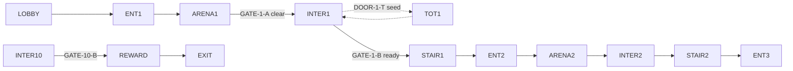

# P55: Explorable physical towers (prototype: Hollow's Eve)

Status: **built 2026-10-28 for Hollow's Eve (see "As built: the physical tower" at the end); the regional towers can follow the same generator.** Written before the code (TDS gate).
Method: the CTAGE master prompt (Downloads `CobbleTowers_Master_Prompt.md`): contract, then macro, floor, room, build.
This doc holds the contract and Phase A. Phases B to D follow one unit at a time.

## Owner decisions

| # | Decision |
|---|---|
| 1 | Prototype on `cobbletowers:halloween`; the design stays modular so the regional towers can follow. |
| 2 | Theme: pumpkins, purple and black blocks, cobwebs, other Halloween blocks. Palette below. Retheme is in scope. |
| 3 | 10 floors, about 97 x 97 footprint, 10-block floor pitch, about 120 tall. |
| 4 | 1 to 4 players; battle rules unchanged. |
| 5 | Linear ascent. Optional **Trick or Treat** gamble rooms (loot chest or another encounter). **No key-gated routes.** |
| 6 | `.schem` preferred. Generate `.schem`, convert to `.nbt` for the game (see Tools). |
| 7 | Modifier cards are **pedestals with gaze holograms**; right-click votes. Gaze feedback is an action-bar prompt plus particles. The web vote stays as a second path into the same `pick()`. |
| 8 | Build the geometry, the walking transition, and the runtime test, not just the plan. |

## What the repo does today (measured)

* A run owns one **cell** (`CellGrid`: 512 span, 256 interior, floor y 64, world 0..384). Each floor's structure is pasted
  once; **all 10 floors share one 93 x 163 x 87 tower** and differ only in anchor Y (31, 42 ... 141).
* The party is **teleported** floor to floor (`TowerEncounters`, `FloorSetup`). The vendor stands at the floor's `exit` anchor.
* Flood fill of the current schematic from the floor-1 entry (`approximate`: slab/stair steps, falls to 3, ladders) reached
  313 standable cells, all at y 29..32. **Nothing connects the halls on foot**, so the walk needs new geometry, not a recut.
* `FloorLayout` carries `entry`, `presentation`, `spectator`, `exit`. A generated tower can emit the same four anchors, so
  the old teleport flow keeps working as the fallback while walking is built behind a per-tower flag.

## Tools (researched 2026-10-26)

| Tool | Finding | Use |
|---|---|---|
| `mcschematic` 11.4.4 (installed) | **Verified:** writes Sponge v2, DataVersion 3953 (1.21.1); the repo's reader parses it and block states survive | **Generator output** |
| `validation/schem_to_structure.py` | Converts `.schem` to vanilla `.nbt`, has a histogram `--check`; drops air and block entities | **Schem to game** |
| `nbtlib` 2.0.4 (installed) | Direct `.nbt` writer | Fallback only |
| WorldEdit / FAWE | `//schem load` previews and hand-polishes a `.schem` in a test world. Not installed here | REQUIRES VERIFICATION on the rig |
| Litematica, Axiom | Client-side preview overlays; need conversion or a format they read | Optional, not relied on |
| GDPC, Amulet | Live-world editors; not deterministic file output, not needed | Rejected |
| nucleation (Rust/Python) | Many formats, unverified | Not needed |

**Format answer:** `.schem` is the authoring and review format and is committed under `validation/schematics/`. The game
only reads vanilla `.nbt` (`StructureTemplateManager`), so the converter output ships. They hold the same block states, so
`.nbt` is not a quality loss. The loss is **air** (cleared by `CellPreparer.reset`) and **block entities** (chests, spawners
are placed by code at runtime, never from the structure).

## Phase A: macro architecture

**Coordinates.** Tower-local T = (0,0,0) at the NW corner of the foundation at the paste origin; +X east, +Z south, +Y up.
Bounds are integer, inclusive. World = paste origin + local, where the paste origin is `CellTickets.pasteOrigin`.
Unrotated only; no module rotates or mirrors in the prototype.

**Envelope.** [0,96] x [0,120] x [0,96] (97 x 121 x 97). Foundation y 0..5 (plinth), 10 floors, crown above floor 10.

**Y schedule** (feet level; slab is 2 thick; clear height 8):

| Floor | Feet y | Clear to | Slab y |
|---|---|---|---|
| F01 | 6 | 13 | 14-15 |
| F02 | 16 | 23 | 24-25 |
| F03 | 26 | 33 | 34-35 |
| F04 | 36 | 43 | 44-45 |
| F05 | 46 | 53 | 54-55 |
| F06 | 56 | 63 | 64-65 |
| F07 | 66 | 73 | 74-75 |
| F08 | 76 | 83 | 84-85 |
| F09 | 86 | 93 | 94-95 |
| F10 | 96 | 103 | 104-105 |

Crown top y 120; world y 64..184 (limit 384).

**Floor modules** (one set per floor, Phase B places them):

| ID | Role |
|---|---|
| `ENT-k` | landing where the stair arrives |
| `ARENA-k` | battle hall: entry, presentation and spectator anchors |
| `INTER-k` | intermission room: vendor, three modifier pedestals, ready area |
| `TOT-k` | optional Trick or Treat room off `INTER-k`, floors 1 to 9 |
| `STAIR-k` | 10 steps, 1:1, from F`k` to F`k+1`, with a slab opening over the last 5 columns |

**Graph** (authoritative table is generated by `validation/p55_phase_a_check.py`):

Gates: `GATE-k-A` opens when floor `k` is won; `GATE-k-B` opens when the ready countdown completes; `DOOR-k-T` opens
only when the run seed rolled a Trick or Treat on that floor (otherwise it is a pumpkin wall). Gate state is **derived from
run state, never stored**, so a restart rebuilds it.

**Pacing (assumption, not measured):** walking adds about 20 to 30 s per floor to the existing battle time.

**Exterior and interior agree:** the crown dome sits over `ARENA-10`; each floor has window bays on the arena ring; the stair
shaft shows as a lit tower on one face. Phase B fixes the faces.

### Palette (roles; block ids REQUIRES VERIFICATION against the 1.21.1 jar, which `retheme_schem.py --minecraft-jar` does)

| Role | Blocks |
|---|---|
| Structure | `blackstone`, `polished_blackstone_bricks`, `deepslate_bricks` |
| Surface | `purple_concrete`, `purple_terracotta`, `black_concrete`, `purpur_block` |
| Trim | `crying_obsidian`, `amethyst_block`, `polished_blackstone` slabs and stairs |
| Biome | `pumpkin`, `carved_pumpkin`, `jack_o_lantern`, `cobweb`, `dead_bush`, `candle` |
| Lighting | `jack_o_lantern`, `soul_lantern`, `shroomlight`, purple stained glass |
| Landmark | `orange_concrete` accents, `purple_stained_glass` dome |

**Cobweb rule:** webs slow players, so they go only above head height (feet + 3) or in cells off every route; never inside
a protected walking volume. The validator rejects a web inside one.

## Integration contract (REQUIRES IMPLEMENTATION, none exists)

| Marker | Event | Owner | Effect | Persistence |
|---|---|---|---|---|
| `PED-k-0..2` | draft open | `PedestalService` (new) | spawn `text_display` + `interaction`, `block_display` stand, tagged by run and card | none; rebuilt from the draft |
| pedestal click | `UseEntityCallback` | same | `IntermissionService.pick` | the draft's own votes |
| `GATE-k-A/B` | state change | `TowerGates` (new) | set or clear barrier blocks in a bounded volume | derived |
| `ARENA-k` volume | party gathered | `FloorEntryTrigger` (new) | start floor `k` when all live participants stand inside | run state |
| `TOT-k` | seed rolls | P34b events | chest or encounter | existing event state |

**Walking transition:** a tower flag `walk: true` switches `RunTransitionService` from "teleport to next entry" to
"open `GATE-k-B`, wait for arrival, then start". Checkpoint resume stands the party at the room that matches the run state.
Disconnect: a missing player at the stair gate does not block it past the existing ready timeout (reuse the countdown rules).

**Gaze:** server-side, one throttled ray test (every 4 ticks) against only that run's pedestal hitboxes (bounded by the
run's UUID tag, not a level scan). Action bar "Click to vote: name" plus a light particle ring. Per-viewer glow packets are
not built.

## Build order (each step shippable)

1. **Pedestal runtime** on the current tower, anchored from the vendor `exit` anchor. Proves hologram, click and gaze.
2. **Generator**: module library in Python on `mcschematic`, a walk-graph validator (the flood fill, pass criteria: every
   gate-open route connects `ENT` to `EXIT`), `.schem` committed, `.nbt` converted.
3. **Layout fields and gates** in `FloorLayout`, `TowerGates`, `FloorEntryTrigger`, behind `walk`.
4. **Rig test**: bot walks the tower (REQUIRES VERIFICATION that `raidbot.js` can path up stairs).
5. **Trick or Treat rooms**, then the retheme polish.

## Validation (Phase A)

| Check | Status | Evidence |
|---|---|---|
| Y schedule fits world and cell | PASS | `p55_phase_a_check.py`: top y 184 < 384; 97 <= 256 |
| Stair lands on the next surface | PASS | 6 + 10 = 16 |
| Stair headroom | PASS (arithmetic) | steps 5..9 need the slab opening; 5 columns |
| Graph reachable, TOT optional, acyclic gates | PASS | same script, 51 nodes |
| Current halls connected on foot | FAIL (approximate) | flood fill, 313 cells, y 29..32 only |
| 8-block clear height suits large Pokemon | NOT TESTED | needs the rig |
| Battle presentation in a continuous building | REQUIRES RUNTIME TEST | |
| Pedestal click and gaze | REQUIRES RUNTIME TEST | |
| Block ids exist in 1.21.1 | NOT TESTED | run the jar check in step 2 |

## Open for the owner

1. Is the event window UTC or local time (carried over from P54)?
2. Trick or Treat encounter: reuse a normal floor opponent, or a distinct weaker "trick" pool?
3. Fall protection: glass and rails everywhere on open balconies, or allow falls to the void and respawn at the room?

## Owner answers (2026-10-26)

1. Event window is **Eastern time**: `halloween.json` now reads 2026-10-31T04:00Z (EDT) to 2026-11-03T05:00Z (EST).
2. Trick or Treat encounters use the **same pool** as the floor. A **rare catchable encounter** reskinned from the CobbleRaids
   catch screen is wanted: not designed; read how that screen is driven before promising anything.
3. **Invisible barrier blocks** stop players jumping out; they belong in the generator's wall spec (Phase B/C).

## As built: step 1, pedestal runtime (2026-10-26)

* `intermission/PedestalRules` (pure, 10 tests): tags, row layout 4 blocks from the vendor toward the spectator anchor, ray test.
* `intermission/PedestalService`: per card a `block_display` stand, a `text_display` hologram and an `interaction` click box.
  Right-click (main hand) calls `IntermissionService.pick`; the hologram count updates at once (`refresh`) and once a second
  (`sync`); a throttled (4 tick) gaze test over the player's own run's slots gives an action-bar prompt and per-player
  particles. Opt-in per tower with `pedestal_votes` (Halloween only); the web vote is unchanged.
* Entities carry `cobbletowers_pedestal_run:<uuid>` and `..._card_<n>` tags; they are removed on leaving the intermission and
  on cell release, discarded on load when the run is not at an intermission, and rebuilt from the draft after a restart.
* **Bug found and fixed:** `VendorNpc.spawn` resolved anchors from the cell corner (`CellGrid.originOf`) instead of the paste
  origin (`CellPreparer.originFor`), so the vendor stood about 80 blocks from the hall. The old live test teleported the bot to
  the vendor, so it never noticed. Now fixed and checked by distance to the pedestals.
* An event room (P34b) opens a **second round** on the same pedestals; they re-sync to the new cards.

Checks: `gradlew test` 915 pass; `validate_definitions.py` PASS; `smoke/pedestal_test.py` 15/15 on the rig (real bot clicks);
`validation/pedestal_shots.py` drives a real client (needs the resource-pack Proceed click, done by `click_window.ps1`) and
photographed overview, gaze, settled and side views.

Seen in the pictures, still to tune: hologram text is small from 7 blocks and long lines clip; descriptions crowd the vendor's
name tag; text vertical anchor (`TEXT_HEIGHT`) is a guess that looks right. Not yet seen: a multi-player click in a real client.

## As built: the physical tower (2026-10-28)

What the plan above became, smaller where it was cheaper to be exact.

* **Generator** `tools/halloween_tower/hollow_tower.py` builds the whole tower in a numpy grid, checks it, and writes `validation/schematics/hollow_tower.schem`
  (Sponge, via `mcschematic`) and `hollow_tower.layout.json`. `validation/schem_to_structure.py` converts it to
  `data/cobbletowers/structure/battle_tower_halloween.nbt` (97 x 114 x 97, 361,702 blocks, 1.0 MB; the same size as the old towers). Run it again after any
  change, then the converter with `--check`, then `python validation/validate_definitions.py`.
* **Plan of one floor** (odd floors; even floors are the mirror image, so the stair of one lands in the arrival hall of the next): arrival hall (west) with a door into the
  arena; the arena in the middle; gate A (iron bars) in its north wall into the intermission room (vendor on a dais and the three pedestals); gate B (iron bars) from that
  room into the stair hall (east); ten steps up, 1:1, through a hole in the slab, with wall caps round the hole above. South of the arena, behind a long glass window, a
  gallery holds the spectator anchor. Floors are ten blocks apart (feet y = 6 + 10 (k - 1)), eight blocks clear. Floor 10 has no stair: its cycle ends by teleport.
* **Validator** (`validate()` in the generator, `test_hollow_tower.py`, 12 mutation tests): flood fill on foot over the blocks. With both gates shut the party reaches the arena and
  nothing else; gate A open adds the vendor's room; both open adds the next floor's arena door; no floor reaches the arena of the one below; no cobweb in the walking volume.
  Every mutation (an open gate, a walled door, a missing step, a filled hole, a cobweb) fails with its own message.
* **Data**: the ten `floors/halloween/floor_NN.json` name the new structure, the four anchors and two new boxes, `gate_a` and `gate_b` (`FloorBox`). `validate_definitions.py`
  checks each box lies inside the structure and is shut as built. A floor with `gate_b` is left on foot; a floor without one (floor 10) is left by teleport as before.
* **Runtime**:
  * `TowerGates.openA` at the intermission (the floor is won), with `rescueFromGallery` for anybody revived on the ledge; `openB` when the countdown ends.
  * The intermission then *walks* (`IntermissionRound.beginWalk`, `WalkRules`): the next floor begins when every fighter who is online is within 7 blocks of its entry anchor, or after 90 s.
  * `TowerEncounters.arrive` teleports only those who are not already there.
  * `TowerGates.closeBoth` shuts the gates again as a floor begins, for the second cycle of an ascending tower, which fights the same building again.
  * A walkable tower has no route-map detours (`DraftService.detourFor`): the party never leaves the building.
* **Live check** `validation/smoke/walk_tower_test.py` (real physics via `walkbot.js`): two players climb floors 1 to 10 on foot, gates shut and open as designed, nobody teleported, the stair
  rises ten blocks, and the cycle's end starts the next cycle by teleport. Passed on the rig.
* **Not built**: Trick or Treat rooms (the gallery is where they would go), per-viewer glow, a roof stair, the real-client look of the floors beyond the screenshots in the session
  notes, multi-player timing with the 90 s straggler teleport.

## As built, v2: doors, stop rooms and the exterior (2026-10-29)

The first plan above (arena, gate A, a vendor room, gate B) became the shape of the route map.

* **One floor** is: the gothic battle hall; gate A; the intermission room with the vendor and the three pedestals; a wall with **three doors**, one per route lane (west to east); a separate
  chamber behind each door, dressed for the kind of stop that lane holds (`rooms.py`: battle, rest, shrine, gambler, forge, library, vault, pool; the data is the eight
  `structure/room_*.nbt`, dressed at runtime by `RoomDresser`); a corridor joining the three chambers; gate B; the stair hall and the stair to the floor above.
* **Doors** (`FloorDoor`: `open` box, `frame` box, `pedestal` anchor). All three are iron bars while the floor is fought. The pedestals sit in front of the doors; when the vote settles
  (`PedestalRules.atDoors`, `TowerDoors`) the door of the winning lane opens and its frame lights (shroomlight). A floor whose draft has no lanes (a relic or event draft)
  opens a door of its own. The validator (`validate()`) proves the party reaches the next floor's entry through each door and gate B, and nothing earlier.
* **Exterior** `tools/halloween_tower/exterior.py` dresses the building from the reference (gothic cathedral-castle): a floating rocky island with a stepped base, a path and stair
  to the gatehouse (rose window), four round corner towers (a floating crystal over one), a hipped roof with a central spire, glowing pointed windows in the skin, crystal spikes and dead trees.
  **It never writes inside the building** (only the outer skin and above the roof); the generator re-runs the walk validator on the dressed canvas, and the canvas is then cropped
  to its blocks, because the structure converter anchors on the lowest block. The anchors in the floor JSON are moved by that offset: `python tools/halloween_tower/apply_layout.py`.
* **Structure**: `battle_tower_halloween.nbt` is now 136 x 215 x 137 (700,330 blocks, 2.0 MB). It fits a cell (256 interior) and the dimension (384 tall, floor at y 64).
* **Order to regenerate**: `hollow_tower.py --loot-tables <blocks dir>` (builds, validates, writes schem + layout), `apply_layout.py`, `schem_to_structure.py` then `--check`,
  `validate_definitions.py` (about two minutes: it reads the structure to check 216 anchors), `preview.py out.png [yaw]` for a quick picture without a client.
